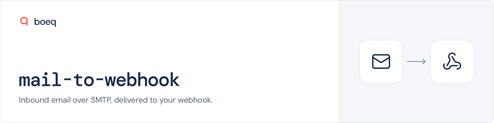

<a href="https://boeq.ai">
  <picture>
    <source media="(prefers-color-scheme: dark)" srcset=".github/assets/header-dark.png">
    
  </picture>
</a>

# mail-to-webhook

mail-to-webhook is an SMTP server for inbound messages. It posts each message to your HTTP endpoint as JSON.

You can use it as a self-hosted replacement for the inbound webhook of Postmark. The JSON has the same field names. As a result, a handler for Postmark continues to operate.

The sender gets `250 OK` only after your endpoint answers `2xx`. If your endpoint does not answer, the sender keeps the message and tries again.

```
sender ──SMTP :25──▶ mail-to-webhook ──HTTPS POST──▶ your endpoint
                       │
                       ├─ RCPT TO   allowed domain? known address?   else 550
                       ├─ DATA      parse MIME, build JSON, sign it
                       └─ reply     2xx ▸ 250 · 400/422 ▸ 550 · anything else ▸ 451
```

## Quick start

1. Copy `.env.example` to `.env`.
2. Set `WEBHOOK_URL` and `ALLOWED_DOMAINS` in `.env`.
3. Start the service.

```bash
cp .env.example .env            # set WEBHOOK_URL and ALLOWED_DOMAINS
docker compose up -d
```

The command pulls the image `ghcr.io/boeq/mail-to-webhook`. GitHub Actions builds this image from `main` for `linux/amd64` and `linux/arm64`.

Send a test message:

```bash
python3 - <<'EOF'
import smtplib
from email.message import EmailMessage

msg = EmailMessage()
msg["From"], msg["To"], msg["Subject"] = "you@example.com", "inbound@example.org", "Hello"
msg.set_content("First message.")
msg.add_attachment(b"%PDF-1.4", maintype="application", subtype="pdf", filename="invoice.pdf")
smtplib.SMTP("127.0.0.1", 25).send_message(msg)
EOF
```

Open the operator UI at <http://127.0.0.1:8080/ui/>.

If you do not have an endpoint, use `make run`. This command starts a local instance that posts to its own test receiver.

## What it does

- It reads all types of messages.
  - It reads all character sets, nested multipart messages and inline images.
  - It reads RFC 2047 and RFC 2231 file names and Outlook `winmail.dat` files.
  - It reads forwarded messages, signed messages and bounce messages.
  - If it cannot parse a message, it still delivers the message. It attaches the original as `message.eml`.
- It changes the answer of your endpoint into an SMTP reply.
  - `2xx` accepts the message.
  - `400`, `406`, `410`, `413`, `415` and `422` refuse the message. The sender returns the message to the author.
  - All other answers defer the message, and the sender tries again. This includes `401` and `500`.
  - As a result, a configuration error causes a delay and not a loss.
- It does a check of each recipient before it accepts a message. Refer to [docs/recipient-check.md](docs/recipient-check.md).
  - It can ask your application if an address exists.
  - It refuses unknown addresses at `RCPT TO`, before the sender transmits the content.
  - It keeps the answers in a local list.
- It corrects message data that strict consumers reject. Refer to [docs/payload.md](docs/payload.md).
  - A forwarded message or a blind copy still has your address in `ToFull`.
  - `Date` always has a format that a parser can read.
  - A message without a `Message-ID` gets a stable ID.
- It signs each request. `X-Mail-To-Webhook-Signature` is an HMAC-SHA256 of the timestamp and the raw body.
- It offers STARTTLS. It can get a certificate from Let's Encrypt and renew the certificate automatically. Refer to [docs/deployment.md](docs/deployment.md#starttls).
- It keeps a history for 30 days.
  - The history contains each message, each delivery attempt and each refused recipient.
  - The UI shows the history.
  - You can send a message again from the UI.

## The payload

```json
{
  "FromName": "Alice Böhm",
  "From": "alice@sender.test",
  "FromFull": { "Email": "alice@sender.test", "Name": "Alice Böhm", "MailboxHash": "" },
  "To": "Support <inbound+order42@example.org>",
  "ToFull": [{ "Email": "inbound+order42@example.org", "Name": "Support", "MailboxHash": "order42" }],
  "Cc": "", "CcFull": [], "Bcc": "", "BccFull": [],
  "OriginalRecipient": "inbound+order42@example.org",
  "Subject": "Café invoice ☕",
  "MessageID": "abc123@sender.test",
  "Date": "Thu, 12 Nov 2026 17:25:39 +0000",
  "TextBody": "Please see attached.\r\n",
  "HtmlBody": "<p>Please see <b>attached</b>.</p>\r\n",
  "Headers": [{ "Name": "Message-ID", "Value": "<abc123@sender.test>" }],
  "Attachments": [
    { "Name": "invoice.pdf", "Content": "JVBERi0xLjQgZmFrZQ==", "ContentType": "application/pdf", "ContentLength": 13 }
  ],
  "Envelope": {
    "MailFrom": "alice@sender.test",
    "RcptTo": ["inbound+order42@example.org"],
    "RemoteAddr": "203.0.113.7",
    "Helo": "mail.sender.test",
    "TLS": true,
    "ReceivedAt": "2026-11-12T17:25:39.208Z",
    "Size": 1076
  }
}
```

`Envelope` is the only addition to the Postmark format. It contains the data from the SMTP session. Do not trust the message headers for this data.

For the full field list, refer to [docs/payload.md](docs/payload.md).

## Settings that you will use

| Variable | Purpose |
|---|---|
| `WEBHOOK_URL` | Your endpoint. This is the only mandatory setting. |
| `WEBHOOK_AUTH_USER`, `WEBHOOK_AUTH_PASS` | HTTP basic authentication for the endpoint. |
| `WEBHOOK_SECRET` | The key for the signature header. |
| `ALLOWED_DOMAINS` | The domains for which you receive messages. If it is empty, the service accepts messages for all domains. |
| `RECIPIENT_CHECK_URL` | The endpoint that tells which addresses exist. If it is empty, the check is off. |
| `SMTP_DOMAIN` | The hostname in your MX record. You can give more than one, with commas between them. |
| `ACME_ENABLED` | The service gets a STARTTLS certificate from Let's Encrypt and renews it. |
| `TLS_CERT`, `TLS_KEY` | Your own certificate for STARTTLS. |
| `UI_AUTH_USER`, `UI_AUTH_PASS` | Basic authentication for the operator UI. |

For all settings, refer to [docs/configuration.md](docs/configuration.md). For operation as an MX server, refer to [docs/deployment.md](docs/deployment.md).

## What it does not do

- It does not calculate a spam score.
  - It does not examine SPF, DKIM, DMARC or the message content.
  - Your endpoint receives all headers and can examine them.
  - The recipient check stops messages to addresses that do not exist. It does not stop spam to an address that exists.
- It has no queue. It does not accept a message and then hold it. The queue of the sender gives the reliability. Each mail server has a queue.
- It does not send messages.

## Development

```bash
make check    # vet, unit tests, and an end-to-end run over real SMTP
```

If Go is not installed, Go runs in a container. As a result, Docker, Node and Python 3 are sufficient. Refer to [CONTRIBUTING.md](CONTRIBUTING.md).

## License

MIT. Refer to [LICENSE](LICENSE) and [NOTICE](NOTICE).

<a href="https://boeq.ai">
  <picture>
    <source media="(prefers-color-scheme: dark)" srcset=".github/assets/footer-dark.png">
    
  </picture>
</a>
